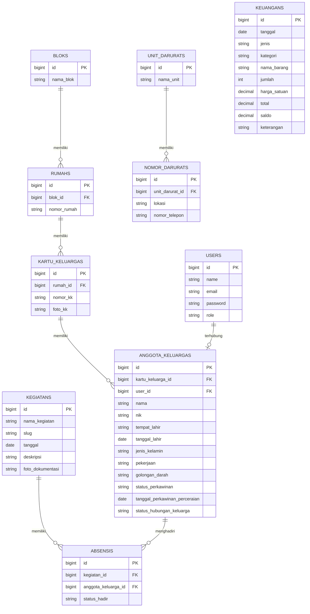

# Product Requirements Document (PRD)
## Sistem Informasi Rumah Tangga (SIRAT) — Rebuild

---

## 1. Latar Belakang

SIRAT (Sistem Informasi Rumah Tangga) adalah aplikasi manajemen administrasi tingkat RT/RW yang sebelumnya sudah dikembangkan oleh tim lain. Project ini merupakan **pembuatan ulang (rebuild)** dari SIRAT versi sebelumnya, sebagai bagian dari **program pengembangan desa**.

Tujuan rebuild ini adalah untuk **memperbaiki kekurangan** dari versi sebelumnya. Aplikasi hasil rebuild ini direncanakan untuk **benar-benar digunakan** oleh RT/RW tertentu, bukan sekadar demo.

> Catatan: Nama produk final masih menggunakan "SIRAT" untuk sementara — rencana penggantian nama masih dalam pembahasan.

---

## 2. Tujuan Produk

Mempermudah pengurus RT dalam mengelola administrasi warga secara digital dan terpusat, mencakup:
- Data kependudukan (blok, rumah, kartu keluarga, anggota keluarga)
- Keuangan RT (pemasukan & pengeluaran)
- Kontak darurat
- Kegiatan warga beserta dokumentasi dan absensi

Dengan SIRAT, pengurus RT diharapkan dapat mengakses data secara efisien dan transparan, serta meningkatkan komunikasi antara pengurus dan warga.

---

## 3. Target Pengguna

| Role | Deskripsi Akses |
|---|---|
| **Admin** (Pengurus RT) | Akses penuh — kelola seluruh data (blok, rumah, kartu keluarga, anggota keluarga, keuangan, nomor darurat, kegiatan) |
| **Warga** | Akses terbatas — 1 akun Warga terhubung (linked) ke 1 data Anggota Keluarga tertentu; dapat melihat data yang relevan bagi mereka |
| **Publik** (tanpa login) | Dapat melihat halaman Beranda tanpa perlu akun |

---

## 4. Ruang Lingkup Fitur

Seluruh fitur dari versi SIRAT sebelumnya dipertahankan tanpa pengurangan:

### 4.1 Login & Logout
- Login dengan email & password, opsi "remember me"
- Role-based access (Admin / Warga)
- Logout dengan konfirmasi

### 4.2 Keuangan
- Melihat data keuangan (tanggal, jenis, kategori, nama barang, jumlah, harga satuan, total, saldo, keterangan)
- Menambah data keuangan
- Mengubah & menghapus data keuangan
- Export data keuangan ke Excel
- Kategori bersifat **input teks bebas** (bukan dropdown tetap)

### 4.3 Nomor Darurat
- Melihat daftar unit darurat (Pemadam Kebakaran, Polisi, Rumah Sakit, dll)
- Melihat nomor telepon darurat per lokasi dalam suatu unit
- Menambah, mengubah, dan menghapus nomor darurat

### 4.4 Kegiatan Warga (+ Berita/Pengumuman Publik)
- Melihat list kegiatan (nama, tanggal, deskripsi)
- Menambah kegiatan baru (dengan foto dokumentasi)
- Mengubah & menghapus data kegiatan
- **Absensi kegiatan dicatat per Anggota Keluarga** (tercatat siapa saja yang hadir, bukan sekadar foto bukti)
- **Halaman publik** — fitur Kegiatan diperluas berfungsi juga sebagai halaman **Beranda** (Berita/Pengumuman) yang dapat diakses siapa saja tanpa login, mengacu pada pola situs Kelurahan Marga Sari (margasari-balikpapan.id):
  - Halaman utama menampilkan beberapa kegiatan/berita terbaru (preview + tombol "Lihat Semua")
  - Halaman list lengkap dengan pagination
  - Setiap kegiatan/berita punya halaman detail sendiri (URL berbasis slug)

### 4.5 Data Blok & Warga
Struktur data bertingkat:
```
Blok → Rumah → Kartu Keluarga → Anggota Keluarga
```
- Blok: tambah, ubah, hapus nama blok
- Rumah: tambah, ubah, hapus nomor rumah (di dalam sebuah blok)
- Kartu Keluarga: tambah, ubah, hapus (nomor KK + foto KK) di dalam sebuah rumah
- Anggota Keluarga: tambah, ubah, hapus data anggota (nama, email, password, NIK, tempat lahir, tanggal lahir, jenis kelamin, pekerjaan, golongan darah, status perkawinan, tanggal perkawinan/perceraian, status hubungan keluarga) di dalam sebuah Kartu Keluarga

---

## 5. Batasan (Constraints)

### 5.1 Tech Stack
| Komponen | Teknologi |
|---|---|
| Backend | Laravel |
| Frontend (template) | Blade |
| Build tool | Vite |
| Admin panel | Filament |
| Auth Warga | Laravel Breeze (terpisah dari login Filament Admin) |
| Database | MySQL |
| CSS | Tailwind (shared config antara Filament & sisi Warga) |
| Export Excel | Maatwebsite/Laravel-Excel |
| Upload file/foto | Laravel Storage (bawaan) |

### 5.2 Deployment
- Wajib deploy publik (ketentuan program pengembangan desa)
- Hosting: **Jagoan Hosting**

### 5.3 Aturan Bisnis Utama
- 1 akun login Warga terhubung ke tepat 1 data Anggota Keluarga
- Kategori pada modul Keuangan bersifat teks bebas, bukan daftar tetap
- Halaman Beranda dapat diakses publik tanpa login

---

## 6. Use Case Diagram

### Aktor
- **Admin** (Pengurus RT) — akses penuh untuk kelola seluruh data
- **Warga** — akses login terbatas, terhubung ke data Anggota Keluarga miliknya sendiri
- **Publik** — tanpa login, hanya dapat mengakses halaman Beranda (Kegiatan/Berita)

### Use Case per Aktor

| Aktor | Use Case |
|---|---|
| Admin | Login & Logout |
| Admin | Kelola data warga (Blok, Rumah, Kartu Keluarga, Anggota Keluarga) |
| Admin | Kelola keuangan |
| Admin | Kelola nomor darurat |
| Admin | Kelola kegiatan |
| Warga | Login & Logout |
| Warga | Lihat keuangan |
| Warga | Lihat nomor darurat |
| Warga | Lihat data keluarga sendiri |
| Publik | Lihat Beranda (kegiatan/berita) |

---

## 7. Entity Relationship Diagram (ERD)



**Catatan relasi:**
- Hierarki utama: Blok → Rumah → Kartu Keluarga → Anggota Keluarga
- 1 akun `Users` (role Warga) terhubung ke tepat 1 `Anggota Keluarga`
- `Absensi` adalah tabel pivot antara `Kegiatan` dan `Anggota Keluarga`, mencatat siapa saja yang hadir per kegiatan
- `Keuangan` berdiri sendiri, tidak punya relasi foreign key ke tabel lain

---

## 8. Wireframe


**Beranda (Publik)** — dapat diakses tanpa login:
- Header: Logo + tombol Login
- Hero section: judul sambutan, tagline, tombol Layanan
- Section Berita/Kegiatan: carousel dengan navigasi kiri-kanan + dots pagination
- Section Tentang + peta lokasi
- Footer: info RT, kontak, sosial media, copyright

**Beranda Warga** — setelah login sebagai Warga:
- Header: Logo + Nama Warga (menggantikan tombol Login)
- Tombol "Kembali ke beranda"
- Hero section: judul sambutan khusus warga
- Section "Layanan": 3 card (Lihat Keuangan, Lihat Nomor Darurat, Lihat Data Keluarga)
- Footer sama seperti Beranda Publik

**Isi Berita/Kegiatan** — halaman detail:
- Header sama seperti Beranda Warga
- Tombol "Kembali ke beranda"
- Judul kegiatan/berita, gambar, isi konten, tombol "Bagikan artikel ini"
- Digunakan khusus untuk detail Berita/Kegiatan

> Catatan: Halaman detail untuk Keuangan, Nomor Darurat, dan Data Keluarga masing-masing akan memiliki layout tersendiri (sesuai jenis kontennya — tabular, daftar kontak, struktur keluarga), namun tetap konsisten secara visual dengan wireframe di atas.

---

## 9. Arsitektur Sistem


SIRAT menggunakan arsitektur **monolith** (bukan pisah frontend-backend/API) — konsekuensi langsung dari pemilihan Laravel + Blade + Filament.

**Alur:**
1. **Browser (Klien)** — Warga, Admin, atau publik mengakses SIRAT lewat browser, mengirim HTTP request.
2. **Jagoan Hosting (Server)** — seluruh aplikasi berjalan dalam satu server:
   - **Blade Views** — merender halaman Publik (Beranda) & Warga (Beranda Warga, Layanan)
   - **Filament** — panel Admin dengan CRUD otomatis
   - **Laravel Breeze** — sistem autentikasi terpisah untuk Warga
   - **Filament Auth** — sistem autentikasi bawaan Filament untuk Admin
3. **MySQL Database** — tempat penyimpanan seluruh data (Blok, Rumah, Kartu Keluarga, Keuangan, Kegiatan, dll), berjalan di server yang sama.
4. **Vite** — bukan bagian yang berjalan saat aplikasi live; hanya digunakan sebelum deploy untuk meng-compile Tailwind CSS & JS menjadi file statis yang dimuat oleh Blade Views.

---

## 10. Belum Ditentukan / Next Steps

- [ ] Wireframe halaman lain (Keuangan, Nomor Darurat, Data Keluarga, Login)
- [ ] Nama final produk (masih "SIRAT" sementara)

---

*Dokumen ini adalah draft awal dan dapat berkembang seiring proses development.*
